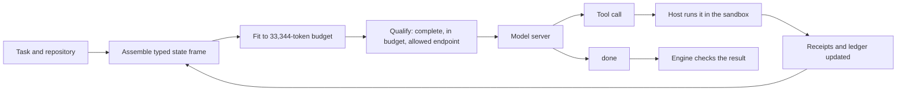
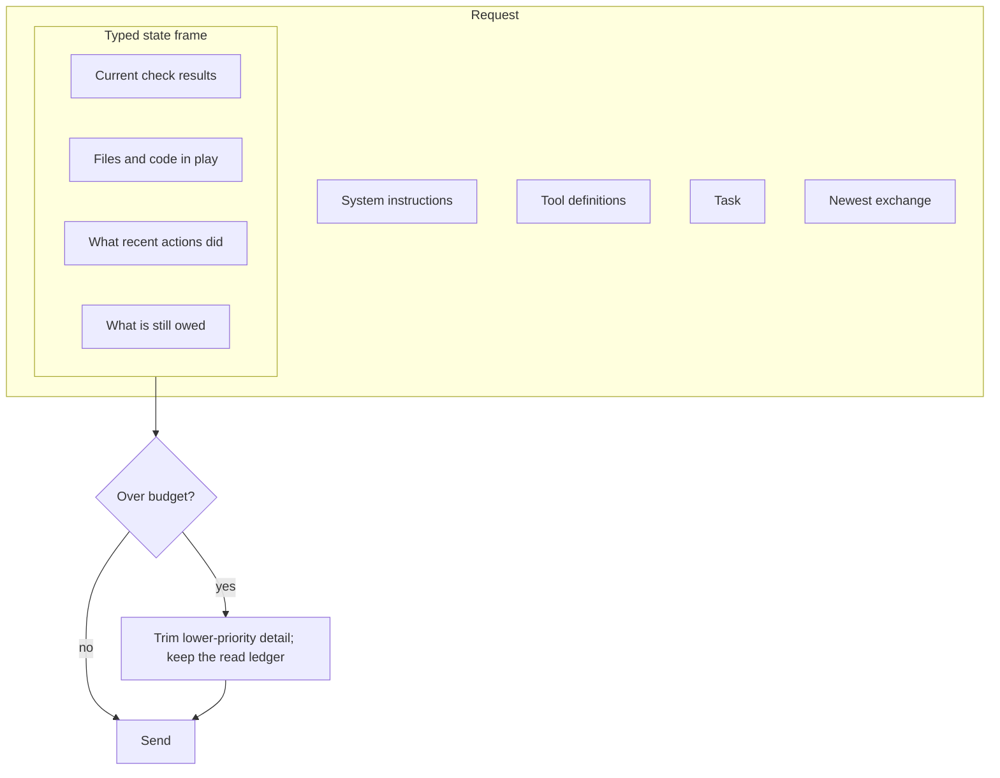
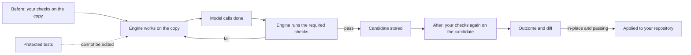
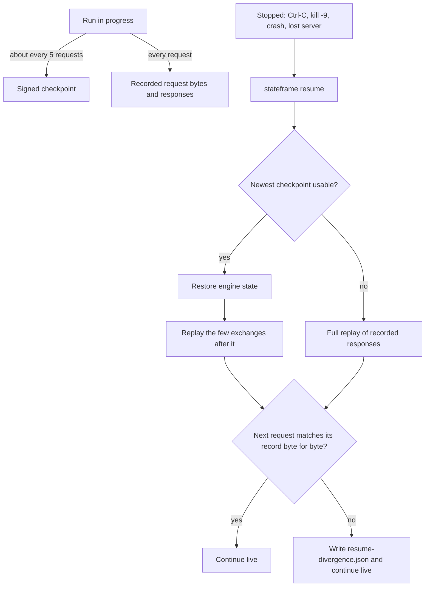
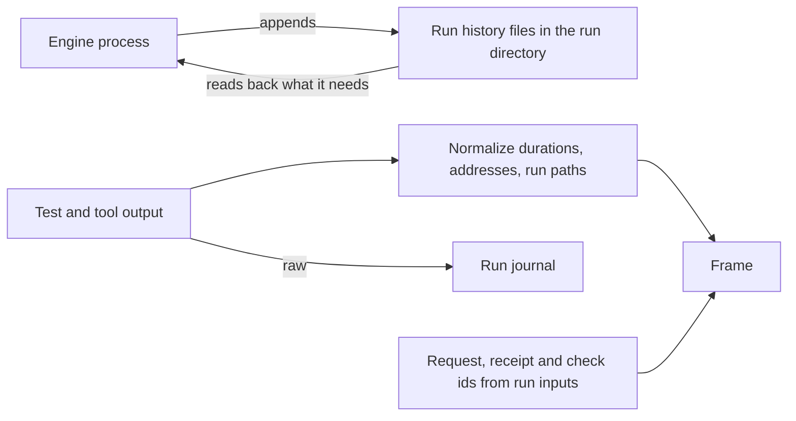
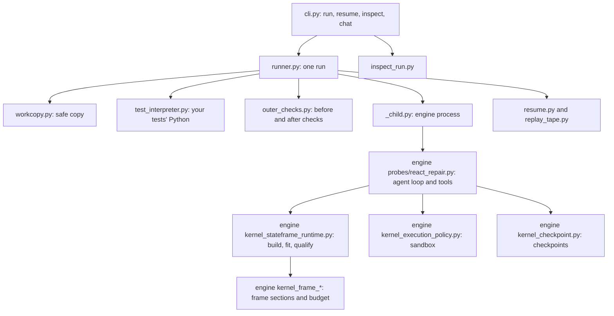

# How StateFrame works

StateFrame runs coding tasks against a local OpenAI-compatible chat server. It never resends the chat history. Instead, every request is rebuilt from the task's current state.

## Request lifecycle

Every turn starts from the engine's typed state, not from a transcript. The engine assembles the frame, fits it to the budget, qualifies the request and sends exactly one sealed body. The model answers with a tool call, the host runs it in a sandbox with no network, and the result lands in the receipts and ledger that the next frame is built from. When the model calls `done`, the engine checks the result instead of taking the model's word for it.

## What a request contains

Each request has five parts: the system instructions, the tool definitions, the task, a typed state frame and the newest exchange (the model's last action and its result). The frame is a set of named sections carrying what the task needs right now. To stay inside the budget the engine trims lower-priority detail; it never summarizes away the authoritative state and always keeps a ledger of what was read. If a task cannot fit what it needs, the engine stops with a clear reason instead of sending a broken request. Older turns stay in the run's records, where `stateframe inspect` shows them.

The model server needs a context slot of 65,536 tokens. These sizes (the 33,344-token budget and the 65,536-token slot) are the ones this release is built and measured with, and both can be changed (see docs/guide/running.md, Context size). Only loopback endpoints are allowed by default; a remote endpoint needs an explicit override and prints a warning, because your source code would leave the machine. A loopback address can still forward elsewhere, so a local address alone does not prove the server is local.

## Completion: who decides a task is done

The model can say it is done; the engine decides. A candidate is stored only after the engine's checks pass, the tests that decide pass or fail cannot be edited by the agent, and StateFrame runs your checks again on the stored result before it reports an outcome. Your repository changes only with `--in-place`, and then only when those checks pass. Your tests run with your project's Python (`--test-python`, the repository's virtual environment, or `python3` on PATH).

## Checkpoints and resume

Every request and response is recorded. With checkpoints turned on (off by default in this release), the engine also saves a signed checkpoint of its state about every 5 model requests. `stateframe resume` loads the newest usable checkpoint, replays only the recorded exchanges after it (no model calls), and checks that the next request it rebuilds matches the recorded one byte for byte before going live. A missing, damaged or foreign checkpoint falls back to a full replay, which is always correct and just slower.

## History on disk and identical requests

Run history lives in the run directory on disk, not in process memory, and the engine reads back what it needs; this is always on and the run directory grows with the run. Request ids come from the run's inputs instead of random values, and volatile test and tool output is normalized before the model sees it, with the raw output kept in the run journal. Identical inputs give identical requests on the measured workload apart from three clock fields and an edit-receipt ID; see KNOWN_LIMITATIONS.md for exactly what can still differ.

## Code map

The product package (`src/stateframe/`) is standard library only and owns the command line, the run directory, the working copy and the checks around a run. The engine (`src/stateframe/engine/`) runs in its own child process and owns everything about a request: the agent loop and tools, building and fitting the frame, sandboxed execution and checkpoints. [docs/guide/code-map.md](docs/guide/code-map.md) lists each module.

## Safety

- **Your repository is not touched** unless you ask. Without `--in-place`, the result stays in the run directory. With `--in-place`, a result is applied only when its checks pass.
- **Protected tests stay protected.** The agent cannot edit the tests that decide pass or fail; an attempted edit never lands in the result.
- **Commands run in a sandbox** (`sandbox-exec` on macOS, bubblewrap on Linux), with no network access.
- **Chat sessions** keep each attempt on a session copy, where `/diff` shows it, `/undo` drops it, and `/apply` applies it to your repository.

## License

StateFrame is licensed under the GNU Affero General Public License v3.0 only (AGPL-3.0-only), or under a separate commercial license from Farside Research LLC (see COMMERCIAL-LICENSE.md). Third-party dependencies keep their own licenses; see THIRD_PARTY_LICENSES.md.
