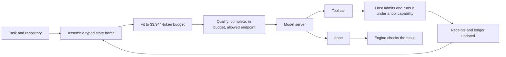
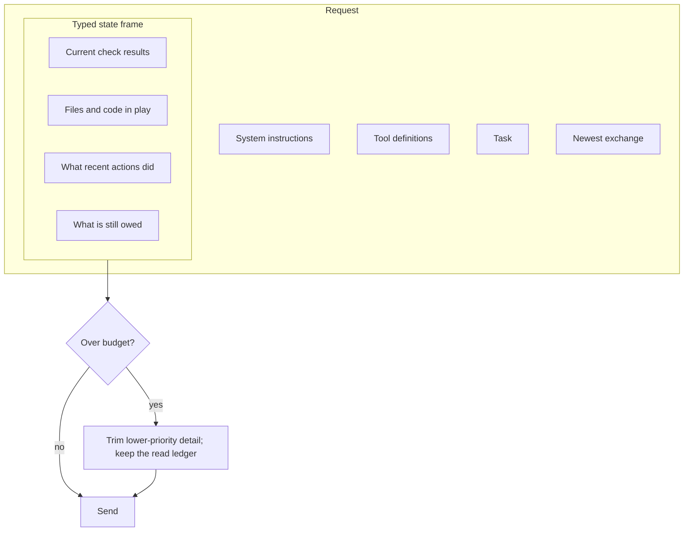
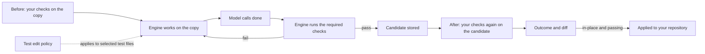
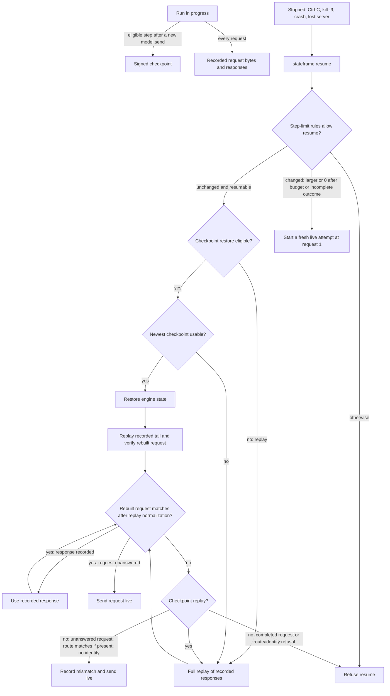
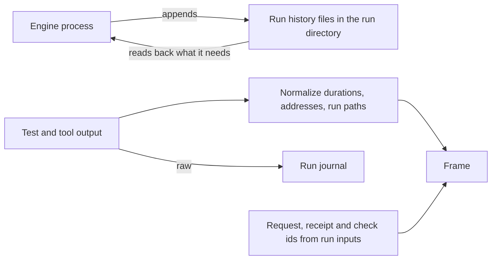
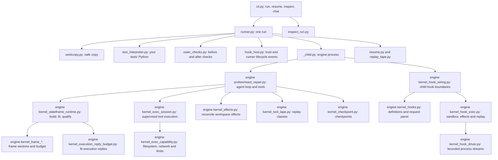
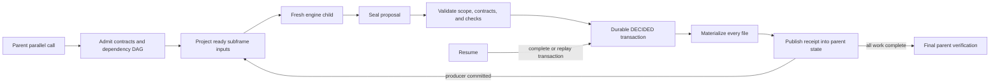

# How StateFrame works

StateFrame runs coding tasks against a local OpenAI-compatible chat server. It never resends the chat history. Instead, every request is rebuilt from the task's current state.

## Request lifecycle

Every turn starts from the engine's typed state, not from a transcript. The engine assembles the frame, fits it to the budget, qualifies the request and sends exactly one sealed body. Shell, job and custom-command reply delivery shrinks against a measurement of the complete request, with omitted byte counts; the original taped observation remains on disk within collector limits. The model answers with a tool call; the host checks its capability and runs it under the selected filesystem and network policy. Authorized file effects become receipts. Jobs appear as a bounded frame section. When the model calls `done`, the engine checks the result instead of taking the model's word for it. See [Agent tools](docs/guide/tools.md).

## What a request contains

Each request has five parts: the system instructions, the tool definitions, the task, a typed state frame and the newest exchange (the model's last action and its result). The frame is a set of named sections carrying what the task needs right now. To stay inside the budget the engine trims lower-priority detail and can shorten opaque execution output in the newest exchange; it never summarizes away the authoritative state and always keeps a ledger of what was read. If a task cannot fit what it needs, the engine stops with a clear reason instead of sending a broken request. Older turns stay in the run's records, where `stateframe inspect` shows them.

The model server needs a context slot of 65,536 tokens. These sizes (the 33,344-token budget and the 65,536-token slot) are the ones this release is built and measured with, and both can be changed (see docs/guide/running.md, Context size). Only loopback endpoints are allowed by default; a remote endpoint needs an explicit override and prints a warning, because your source code would leave the machine. A loopback address can still forward elsewhere, so a local address alone does not prove the server is local.

## Completion: who decides a task is done

The model can say it is done; the engine decides. A candidate is stored only after the engine's checks pass, and StateFrame runs your checks again on the stored result before it reports an outcome. The run's `--protect-tests` setting controls which test files the agent may edit: `all` protects every test, `task` protects the checks selected for the run, and `off` disables test-specific protection. The shipped profile uses `off`. Your repository changes only with `--in-place`, and then only when those checks pass. Your tests run with your project's Python (`--test-python`, the repository's virtual environment, or `python3` on PATH).

## Checkpoints and resume

Every request and response is recorded. The shipped profile enables checkpoint saves. At an eligible step boundary, the engine attempts a signed save after a new model send; the default cadence is one send, and a busy writer may skip a boundary. Save failures do not stop the run. It keeps up to the newest two checkpoints by default and removes them after a completed run unless retention is requested with `--keep-checkpoints` or the equivalent setting. If checkpoint support is unavailable or disabled, resume replays.

Resume restores a checkpoint only when the recorded endpoint, model and step limit still match and no per-step routing, hooks or edit-scope widening are configured. Only a budget or incomplete outcome can resume with a changed step limit, and then only with a larger limit or 0 (no limit); that starts a fresh live attempt at request 1. Other changed limits are refused. Shell-enabled runs can restore checkpoints too; tool operations after the saved point are reconciled through the recorded tool tape. File deletions and moves follow the edit replay path. After restore, recorded exchanges since the checkpoint and the first rebuilt request are checked after replay normalization. Replay normalizes the remaining-time countdown to its recorded value. For an explicitly requested model-name swap, replay may substitute only the leading top-level `model` value. A missing, damaged, foreign or unfaithful checkpoint falls back to full replay, which uses the same request comparison. Full replay refuses a mismatch in a completed request. A mismatch in the unanswered in-flight request is recorded and sent live only if its recorded route matches, when present, and no endpoint identity is attached. Tool-tape or external-effect state can still refuse resume; use `--replay-external` when an external effect requires it.

## History on disk and identical requests

Run history lives in the run directory on disk, not in process memory, and the engine reads back what it needs; this is always on and the run directory grows with the run. Request ids come from the run's inputs instead of random values, and volatile test and tool output is normalized before the model sees it, with the raw output kept in the run journal. Identical inputs give identical requests on the measured workload apart from three clock fields and an edit-receipt ID; see KNOWN_LIMITATIONS.md for exactly what can still differ.

## Code map

The product package (`src/stateframe/`) is standard library only and owns the command line, the run directory, the working copy and the checks around a run. The engine (`src/stateframe/engine/`) runs in its own child process and owns everything about a request: the agent loop and tools, building and fitting the frame, sandboxed execution and checkpoints. [docs/guide/code-map.md](docs/guide/code-map.md) lists each module.

## Parallel subframes

The parent stays blocked in one `parallel` tool step while the host supervises separate engine children. Each child
gets a compiled frame and its own run directory; it never appends to the parent's journal. The host accepts only a
sealed proposal whose owned paths and before-digests match the current parent tree. The redo transaction is durable
before materialization, and the parent receives file-effect publication only after every file is in place. Dependents
start from the committed export projection. Replay and crash recovery use the same transaction publication path.
See [Subframes](docs/guide/subframes.md) for the contract, measured conditions, records, and limits.
## Lifecycle hooks

Hook configuration and project digest trust are resolved by the runner. Start and end events run in the host process through the same execution sandbox. Child events pass through one wiring module that records gate results, notes and scoped formatter changes. The typed `[USER HOOKS]` panel is optional request context; no hook modules are loaded in the child when no hook source is enabled. See [Lifecycle hooks](docs/guide/hooks.md) for the contract and limits.

## Safety

- **Your repository is not touched** unless you ask. Without `--in-place`, the result stays in the run directory. With `--in-place`, a result is applied only when its checks pass.
- **Test-file protection follows `--protect-tests`.** `all` protects every test file, `task` protects the checks selected for the run, and `off` disables test-specific protection. The shipped profile uses `off`.
- **Commands run under a declared policy** (`sandbox-exec` on macOS, bubblewrap on Linux). Shell networking defaults to loopback; full network and host execution require explicit flags. Reconciliation stops without promoting effects beyond 16 MiB per file, 256 MiB aggregate or 20,000 entries. Executable-bit changes are refused and restored. Host PATH discovery admits executables and their symlink and shebang chains without admitting whole parent directories. The [tool guide](docs/guide/tools.md) states the platform limits.
- **Repository-code diagnostics stay inside the execution sandbox.** Imports before the first request, post-edit imports, obligation checks and optional Git indexing use sandboxed execution. Git history `show` is rooted at a commit, so raw blob and tree IDs are refused.
- **The shipped profile uses the composed loop.** Lean mode is not supported by the product profile. The plain loop refuses Git, web and custom-tool settings and background jobs before execution.
- **Chat sessions** keep each attempt on a session copy, where `/diff` shows it, `/undo` drops it, and `/apply` applies it to your repository.

## License

StateFrame is licensed under the GNU Affero General Public License v3.0 only (AGPL-3.0-only), or under a separate commercial license from Farside Research LLC (see COMMERCIAL-LICENSE.md). Third-party dependencies keep their own licenses; see THIRD_PARTY_LICENSES.md.
